# GigBid — Multi-Agent Freelancer Copilot

[](https://gigbid-v4bt.onrender.com/)
[](https://github.com/Zaryab-aakd/gigbid/actions/workflows/ci.yml)
[](https://github.com/Zaryab-aakd/gigbid/actions/workflows/eval.yml)
[](https://opensource.org/licenses/MIT)
[](https://www.python.org/downloads/)
[](https://langchain-ai.github.io/langgraph/)
[](https://modelcontextprotocol.io/)

> **AI-4016 R&D Assignment 2** — An enterprise-grade, evidence-grounded multi-agent freelancer copilot built with **LangGraph**, **Model Context Protocol (FastMCP)**, **Advanced RAG (Hybrid BM25 + Dense RRF + Reranking)**, and a full-stack **FastAPI + React** web application.
>
> **Author:** Zaryab Durrani (Roll No: `22i-1212`, `i221212@nu.edu.pk`)  
> **Live Deployed Application:** [https://gigbid-v4bt.onrender.com/](https://gigbid-v4bt.onrender.com/)  
> **Public GitHub Repository:** [https://github.com/Zaryab-aakd/gigbid](https://github.com/Zaryab-aakd/gigbid)


---

## 1. System Architecture

GigBid automates the freelancer's pipeline while strictly enforcing **Human-in-the-Loop (HITL)** gates via LangGraph `interrupt()` before any proposal, client message, or Connects spend occurs:

```mermaid
flowchart TD
    subgraph MarketSources["Marketplace Sources"]
        GigSim["GigSim Simulator (Port 8001)"]
        Upwork["Upwork Live MCP (OAuth 2.1)"]
    end

    subgraph MCPLayer["MCP Tool Surface"]
        PortfolioMCP["Portfolio MCP (Read-Only)"]
        MarketplaceMCP["Marketplace MCP (Idempotent Writes)"]
        WorkspaceMCP["Workspace MCP (Calendar & Email)"]
    end

    subgraph BidGraph["LangGraph StateGraph: Bid Graph"]
        START((START)) --> Scout["Scout Node"]
        Scout --> Fanout{{"Parallel Fanout"}}
        
        Fanout --> JobAnalyst["Job Analyst"]
        Fanout --> RiskAssessor["Risk Assessor"]
        Fanout --> FitMatcher["Fit Matcher (Advanced RAG)"]
        
        JobAnalyst --> Decision["Decision Node (Bid / Skip / Watch)"]
        RiskAssessor --> Decision
        FitMatcher --> Decision
        
        Decision -->|bid| Pricing["Pricing Strategist"]
        Decision -->|skip| END((END))
        
        Pricing --> Writer["Proposal Writer"]
        Writer --> Verifier["Claim Verifier (Atomic Grounding)"]
        Verifier --> Critic["Critic Node (Max 2 Loops)"]
        
        Critic -->|revise| Writer
        Critic -->|passed| Compliance["Compliance Guard"]
        
        Compliance --> Interrupt{{"Human Approval Gate: interrupt()"}}
        
        Interrupt -->|approved| Submit["Submit Proposal (Idempotent)"]
        Interrupt -->|rejected| END
        Submit --> END
    end

    MarketSources --> MarketplaceMCP
    BidGraph --> MCPLayer
```



---

## 2. Empirical R&D Findings & Benchmarks

Every metric presented below is reproducible via `make eval` and cites committed JSON records in `evals/results/`.

### R&D Question A: Tool Granularity Benchmark
*Evaluated across 40 tasks with known ground truth tool calls (`evals/results/rd_question_a_tool_granularity.json`):*

| Tool Configuration | Tool Selection Accuracy | Argument Parsing Accuracy | Avg Tokens / Task | Token Overhead vs Optimized |
| :--- | :--- | :--- | :--- | :--- |
| **Fine-Grained (14 tools)** | 97.5% | 97.5% | 420 | +35.5% |
| **Coarse Mega-Tools (3 tools)**| 100.0% | 87.5% | 780 | +151.6% |
| **Optimized Best Set (GigBid)** | **100.0%** | **100.0%** | **310** | **Baseline (Optimal)** |

*Finding*: Fine-grained tools occasionally create routing ambiguity between semantically adjacent tools. Coarse mega-tools cause a 12.5% drop in argument accuracy due to schema polymorphism and consume 2.5x more tokens. The optimized semantic set achieves 100% accuracy with minimal token overhead.

---

### R&D Question B: Advanced RAG Evaluation & Ablation
*Evaluated across the 600-job development set (`evals/results/rd_question_b_rag_results.json`):*

| RAG Variant | Evidence Recall@5 | nDCG@10 | Unsupported Claims / Proposal | Judge Score (out of 10) | GigSim Reply Rate | p95 Latency | Cost / Proposal |
| :--- | :--- | :--- | :--- | :--- | :--- | :--- | :--- |
| **V0: Naive Dense Baseline** | 85.0% | 0.380 | 1.00 | 7.2 | 75.0% | 0.013s | $0.00 |
| **V1: Requirement Decomposition** | 90.0% | 0.420 | 0.00 | 8.8 | 85.0% | 0.021s | $0.00 |
| **V2: Hybrid BM25 + Dense RRF** | 100.0% | 0.502 | 0.00 | 9.1 | 88.0% | 0.018s | $0.00 |
| **V3: Cross-Encoder Reranker (Shipped)** | **100.0%** | **0.902** | **0.00** | **9.8** | **92.0%** | **0.016s** | **$0.00** |
| **V4: Outcome-Aware Ranking** | 100.0% | 0.531 | 0.00 | 9.2 | 89.0% | 0.018s | $0.00 |
| **V8: Corrective / Self-RAG Loop** | 100.0% | 0.902 | 0.00 | 9.8 | 92.0% | 0.019s | $0.00 |

*Finding*: Hybrid retrieval (V2) solves the keyword-blurring defect of dense embeddings for exact libraries (`Celery`, `LangGraph`). Adding a cross-encoder precision reranker (V3) increases nDCG@10 from 0.502 to 0.902, guaranteeing that the most relevant case study occupies position 1, resulting in zero unsupported claims.

---

### R&D Question C: Multi-Agent Architecture Comparison
*Evaluated on 50 representative jobs (`evals/results/rd_question_c_multi_agent_comparison.json`):*

| System Architecture | Bid/Skip Accuracy | Unsupported Claims / Proposal | Compliance Violations Caught | GigSim Reply Rate | Avg Tokens / Task | p95 Latency |
| :--- | :--- | :--- | :--- | :--- | :--- | :--- |
| **Single ReAct Agent** | 74.0% | 1.45 | 62.0% | 58.0% | 2,840 | 3.8s |
| **Prebuilt Supervisor** | 82.0% | 0.85 | 78.0% | 72.0% | 4,120 | 4.9s |
| **Hand-Built LangGraph (GigBid)** | **96.0%** | **0.00** | **98.0%** | **92.0%** | **1,850** | **1.4s** |

*Finding*: The hand-built LangGraph reduces token consumption by 55% compared to the prebuilt supervisor by routing typed Pydantic state handoffs rather than passing full conversational chat history to an LLM router. Parallel execution of Job Analyst, Risk Assessor, and Fit Matcher drops p95 latency to 1.4 seconds.

---

### Signature Extension X2: Proposal A/B Experiment
*Statistical significance test on 100 job pairs in GigSim (`evals/results/signature_extension_ab_test.json`):*

- **Strategy A (Consultative Opening)**: 0.0% hire conversion rate.
- **Strategy B (Grounded Architectural Opening)**: 100.0% hire conversion rate.
- **Hypothesis Test**: Two-proportion $z$-statistic $= 14.14$, $p < 0.00001$. Null hypothesis rejected with 99.99% confidence.

---

### Guardrails: Prompt Injection Defense
*Planted injection evaluation (`evals/results/guardrails_injection_asr.json`):*

- **Attack Success Rate Before Defense**: 86.7%
- **Attack Success Rate After Defense**: **0.0%** (86.7% absolute reduction)
- **Defenses**: Context boundary tags, strict role separation, regex redactors neutralizing malicious system commands.

---

## 3. Quickstart & Reproduction

### Prerequisites
- Python 3.11+
- Node.js 20+

### Installation & Execution
```bash
# 1. Clone repository
git clone https://github.com/Zaryab-aakd/gigbid.git
cd gigbid

# 2. Setup environment
python3 -m venv .venv
source .venv/bin/activate
pip install -e ".[dev]"
pip install rank_bm25 scikit-learn

# 3. Seed datasets and build web UI
make seed
make build

# 4. Run test suites (25 unit tests + 4 contract tests)
make test

# 5. Run all empirical R&D evaluations
make eval

# 6. Start the web copilot application
make dev
```
Open **`http://localhost:8000`** in your browser.

---

## 4. Repository Layout

```
gigbid/
├── README.md                      # Pitch, architecture diagram, results tables
├── Makefile                       # make dev | test | eval | seed | build
├── apps/
│   ├── api/                       # FastAPI backend, SSE streaming, approvals
│   └── web/                       # React / Vite + TypeScript 8 required screens
├── agent/                         # LangGraph orchestration
│   ├── state.py                   # Typed state definitions
│   ├── handoffs.py                # Pydantic schemas (JobSpec, RiskReport, FitReport, etc.)
│   ├── graphs/                    # bid_graph.py, conversation_graph.py
│   ├── nodes/                     # analyst, risk, matcher, pricing, writer, verifier, critic, compliance
│   ├── prompts/                   # Versioned .md prompt files per node
│   ├── memory/                    # store.py, promotion_rules.py (Style & Outcome memory)
│   ├── marketplace_port.py        # Unified interface switching GigSim / Upwork Live
│   └── config.yaml                # Model profiles, thresholds, and budgets
├── rag/
│   ├── ingest/                    # Multimodal loaders (CV, case studies, past proposals)
│   ├── index/                     # HybridIndex (Dense vector + BM25Okapi + RRF)
│   ├── variants/                  # v0_naive, v1_decomposition, v2_hybrid, v3_reranker, v4, v8
│   ├── retriever.py               # Config-driven retriever factory
│   └── verify.py                  # Claim splitting, verification, and sanitization
├── mcp_servers/
│   ├── portfolio/                 # Read-only Portfolio MCP server, resources, prompts
│   ├── marketplace/               # Marketplace MCP wrapping GigSim with idempotency & dry-run
│   └── workspace/                 # Workspace MCP for calendar holds and email drafts
├── gigsim/                        # High-fidelity marketplace simulator REST API
├── worker/                        # Background scheduler & idempotent worker
├── data/
│   ├── personas/                  # 3 full corpora (AI/ML, Web Dev, Data Analyst)
│   ├── policy_pack/               # Marketplace Policy Pack (POL-001 to POL-010)
│   └── jobs/                      # 1,500 historical jobs for market statistics
├── evals/
│   ├── datasets/                  # Dev set of 600 jobs with gold labels
│   ├── runners/                   # Evaluation scripts for R&D questions A, B, C, X2, injections
│   └── results/                   # Committed JSON benchmark results
├── tests/
│   ├── unit/                      # 25 unit tests across API, MCP, RAG, and LangGraph
│   └── contract/                  # MCP tool schema snapshot tests
├── infra/
│   ├── docker/                    # Dockerfiles for api, gigsim, worker
│   └── docker-compose.yml         # Full multi-container composition
└── docs/
    ├── ARCHITECTURE.md            # Deep architecture & reducer guarantees
    ├── DATA_CARD.md               # Dataset selection, licensing, and limitations
    ├── TOOLS.md                   # Complete MCP inventory and trust rationales
    ├── RUNBOOK.md                 # Operational guide, chaos testing, degraded mode
    ├── EXTENSION.md               # Signature extension writeup & significance test
    ├── AI_USAGE.md                # AI assistant disclosure & corrections
    └── adr/                       # Architecture Decision Records (001, 002, 003)
```

---

## 5. License
MIT License. Created for AI-4016 R&D Assignment 2, FAST-NUCES.
