# GigBid Architecture Specification

This document details the multi-agent orchestration, tool layer, state discipline, and data flow of GigBid.

```mermaid
flowchart TD
    subgraph MarketSources["Marketplace Sources"]
        GigSim["GigSim REST Simulator (Port 8001)"]
        Upwork["Upwork Live MCP (OAuth 2.1)"]
    end

    subgraph Port["Unified Port"]
        MarketplacePort["MarketplacePort (Adapter Pattern)"]
    end

    subgraph MCPLayer["MCP Tool Surface"]
        PortfolioMCP["Portfolio MCP (Read-Only)"]
        MarketplaceMCP["Marketplace MCP (Idempotent Writes)"]
        WorkspaceMCP["Workspace MCP (Calendar & Email)"]
    end

    subgraph BidGraph["LangGraph StateGraph: Bid Graph"]
        START((START)) --> Scout["Scout Node"]
        Scout --> Fanout{{"Parallel Fanout (Send)"}}
        
        Fanout --> JobAnalyst["Job Analyst"]
        Fanout --> RiskAssessor["Risk Assessor"]
        Fanout --> FitMatcher["Fit Matcher (Advanced RAG)"]
        
        JobAnalyst --> Decision["Decision Node (Bid / Skip / Watch)"]
        RiskAssessor --> Decision
        FitMatcher --> Decision
        
        Decision -->|bid| Pricing["Pricing Strategist"]
        Decision -->|skip / watch| END((END))
        
        Pricing --> Writer["Proposal Writer"]
        Writer --> Verifier["Claim Verifier (Atomic Grounding)"]
        Verifier --> Critic["Critic Node"]
        
        Critic -->|failed & iter < 2| Writer
        Critic -->|passed / iter >= 2| Compliance["Compliance Guard"]
        
        Compliance --> Interrupt{{"Human Approval Gate: interrupt()"}}
        
        Interrupt -->|approved| Submit["Submit Proposal (Idempotent)"]
        Interrupt -->|rejected| END
        Submit --> END
    end

    subgraph ClientLiaisonGraph["LangGraph StateGraph: Conversation Graph"]
        C_START((START)) --> Liaison["Client Liaison"]
        Liaison --> Intent["Intent Classification"]
        Intent --> WorkspaceHold["Workspace MCP Hold"]
        WorkspaceHold --> C_Interrupt{{"Message Approval: interrupt()"}}
        C_Interrupt -->|approved| Send["Send Message"]
        Send --> C_END((END))
    end

    MarketSources --> MarketplacePort
    MarketplacePort --> MarketplaceMCP
    BidGraph --> MCPLayer
    ClientLiaisonGraph --> WorkspaceMCP
    ClientLiaisonGraph --> MarketplaceMCP
```

---

## Agent Roles & Responsibilities

| Node / Agent | Role & Responsibility | Tool Access | State Hand-off Output |
| :--- | :--- | :--- | :--- |
| **Scout** | Polls saved searches on schedule, deduplicates, and queues new jobs | `search_jobs` | Raw job payload |
| **Job Analyst** | Extracts deliverables, core skills, budget boundaries, and screening questions | None | `JobSpec` |
| **Risk Assessor** | Scores client history, flags scams, unmasks off-platform asks, and neutralizes prompt injections | `get_client_history` | `RiskReport` |
| **Fit Matcher** | Maps job requirements to verified portfolio case studies via RAG V3 reranker | `search_evidence` | `FitReport`, `evidence` |
| **Pricing Strategist**| Calculates fair bid band, client historical spend, and Connects ROI | `get_connects_balance`| `PricingQuote` |
| **Proposal Writer** | Drafts customized cover letter with `[case-ID]` citations and answers screening questions | None | `ProposalDraft` |
| **Claim Verifier** | Splits proposal into atomic assertions and classifies support status against portfolio evidence | None | `ClaimVerificationReport` |
| **Critic** | Reviews grounding, length (120-280 words), and tone; enforces max 2 revision loops | None | `CritiqueReport` |
| **Compliance Guard**| Enforces Marketplace Policy Pack (POL-001 to POL-010); strips contact info & guarantees | None | `ComplianceVerdict` |
| **Human Approval** | Pauses execution via LangGraph `interrupt()`, awaiting user edit/approval in Web UI | None | `approval_status` |
| **Client Liaison** | Reads client replies, classifies intent, reserves calendar holds, drafts responses | `get_calendar_availability`, `create_interview_hold` | `ConversationState` |

---

## State Discipline & Reducer Guarantees

All state interactions adhere strictly to `GigBidState`:
- State is typed via Pydantic and TypedDict models.
- Parallel branches execute independently without conflicting writes.
- Checkpointer (Postgres / Memory) persists complete state snapshots at every node, enabling exact-once crash recovery and replayability.
